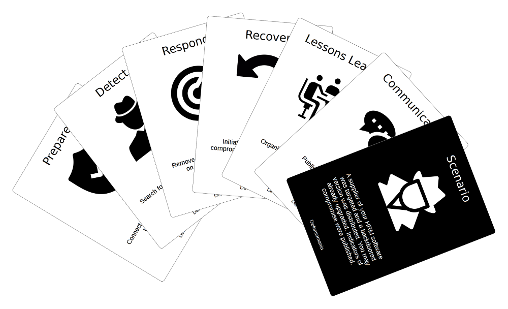
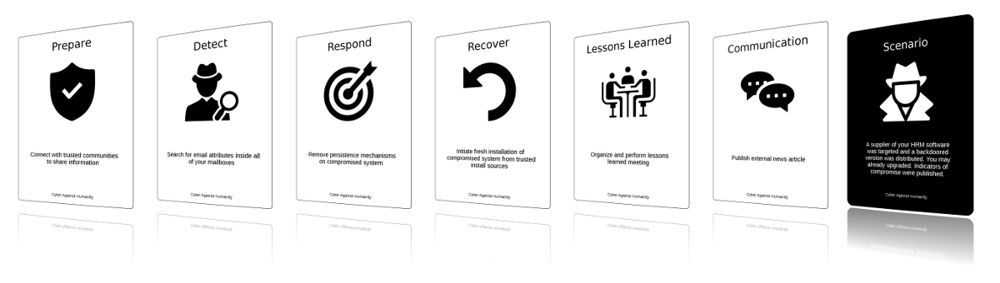
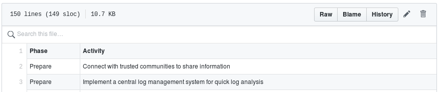

  

# Defensomania

Defensomania (formerly _Cyber Against Humanity_) is an incident response card
game. Your web server is compromised: which steps do you take first? Malware
ran on an endpoint and shortly after you see data leaving for a remote server:
what are your priorities?

**Website: https://karneades.github.io/Defensomania/**

Play Defensomania with the provided scenarios to train defenders and to
discuss activities and their priorities. _How would you implement those
activities in your environment?_ The activity cards follow well-known incident
response phases and focus on threat detection and response.

In each round, one player is the attacker and reads a scenario card. All other
players are defenders and pick their best activity card. See
[Gameplay](#gameplay) for the rules.

Defensomania is for security monitoring and incident response what
["Elevation of Privilege"
(EoP)](https://www.microsoft.com/en-us/download/details.aspx?id=20303) is for
threat modeling and
[Cornucopia](https://www.owasp.org/index.php/OWASP_Cornucopia) is for web
application security.

_**Disclaimer:** Defensomania is a personal project developed in spare time.
The scenarios are fictional or based on external write-ups._

## Download

Get the print-ready files from the
[latest release](https://github.com/Karneades/Defensomania/releases/tag/deck-latest).
It contains all PDFs and a zip with all PNG files, and it is rebuilt
automatically whenever the cards or the layout change.

Which file to use depends on how you print:

* **At home:** use `Defensomania-9-cards-per-sheet-all-front-without-bleed.pdf`.
  It contains all scenarios and activities with 9 cards per sheet.
* **At a print shop or a custom card manufacturer:** the required files vary.
  Some want PDFs with 1 card per sheet, others want PNG images (the PNG zip).
  Front and back usually have to be provided separately. Both formats include
  the usual 1/8" bleed around the card, which is cut away after printing.

## Card Deck

__Future versions will use ATT&CK for additional attack events during the game
and RE&CT for the activity cards instead of an internal activity list.__

There are two types of cards:

* [Scenarios](cards/scenarios.tsv) describe fictional security incidents.
* [Activities](cards/activities.tsv) describe the steps used to handle them.

The _Source_ column in the [card files](cards) credits external content.

Activity cards are grouped by these incident response phases:

* Prepare
* Detect
* Respond
* Recover
* Lessons Learned
* Communication

More activity cards mean more ways to react during the game, so
[consider adding more scenarios and activities](#contributing).

## Gameplay

Choose a mode based on what your team wants to practice:

* **Best card wins:** discuss single activities and how well they fit a
  scenario.
* **Incident response process:** walk through one scenario from start to end.

### Best card wins

1. Put the scenario cards face down in the middle of the table.
1. Each player draws ten activity cards and keeps them hidden. Skip the _joker_
   cards.
1. One player is the attacker. The attacker takes the first scenario card and
   reads it out loud.
1. Each defender passes the best activity card, face down, to the attacker.
   _Alternative:_ each defender explains the proposed activity instead. You can
   also include the joker cards.
1. The attacker shuffles the cards, reads all activities out loud and picks
   the best one. Whoever submitted it wins the scenario card as a defend point.
1. Discuss the decision technically and how you would implement it in your
   environment. Useful questions by phase:
    * **Prepare:** what should have been in place to be ready for this scenario?
    * **Detect:** how could you identify the attack, or the malicious activity
      happening right now?
    * **Respond, Recover, Communication and Lessons Learned:** how would you
      respond to the incident?
1. Everyone draws back up to ten cards.
1. The next player becomes the attacker and a new round begins.

### Incident response process

This mode is a more in-depth way of dealing with one scenario. The goal is to
see how your team would handle a fictional incident from beginning to end.
Discuss processes, responsibilities, tools, priorities and who to contact in an
emergency. Example questions:

* "If we have this incident, what preparation do we need to handle it?"
* "If we must contain the compromised host, how would we do that?"
* "If we add a new subsidiary to our monitoring and incident response scope,
  how would we handle this scenario for its infrastructure?"

Steps:

1. Put the scenario cards face down in the middle of the table.
1. Group the activity cards face up by phase.
1. One player takes the first scenario card and reads it out loud. Good luck.
1. Spread out the activity cards of the first phase, _Prepare_, around the
   table.
1. In turn, each player takes one card from the current phase that fits the
   scenario and describes the steps and tools used to carry it out. Discuss
   the activity and its priority for the scenario as a group.
1. When all relevant cards of a phase are played, move on to the next phase.

## Contributing

You can add [scenarios and activities](cards), improve wording and rules, or
improve the layout and design.

### Adding or changing cards

The cards are in [activities.tsv](cards/activities.tsv),
[scenarios.tsv](cards/scenarios.tsv) and [worst.tsv](cards/worst.tsv). Please
follow these rules:

* Keep the `Activity` text to **170 characters or fewer**, including spaces.
  Longer text does not fit and is cut off with an ellipsis (`…`).
* Text with many capital letters or long words fits fewer characters (about
  150). If the build prints `Ellipsized (too much text)`, shorten the text.
* Write activities as imperative phrases, for example "Block IPs".
* Keep the columns tab-separated.

### Reviewing a pull request

Every pull request that changes the cards, the layout or the build setup is
built automatically by GitHub Actions. The workflow checks the file format and
the text length and attaches the generated deck to the run as the artifact
`defensomania-deck` (PDFs and a zip with all PNGs).

To see how the cards and PDFs look before merging:

1. Open the **Checks** tab of the pull request.
1. Select the **Build card deck** run.
1. Download the artifact from the **Artifacts** section.

Artifacts expire after a retention period and need a GitHub login to download.

## Build your own Defensomania

Build the card deck yourself using [Squib](https://github.com/andymeneely/squib).
See the [instructions](BUILD.md).

## Ideas

* **Event cards:** inject new events into an otherwise static scenario, such as
  "credentials were stolen from server X", "credentials abused on system X" or
  "data exfiltration identified on server X". The team reacts to each event
  with activity cards.
* **Extra packs**, for example a "Worst Response Pack" with bad activities for
  a scenario about a compromised workstation: "log into the machine as domain
  administrator to search for malware", "forward the maldoc file to a ticketing
  system many people can access" or "announce on Twitter that you were hacked
  before the social media department is informed". See the
  [worst cards](cards/worst.tsv) for examples.
* **PowerShell Against Humanity:** a pack with only incident response
  activities that use PowerShell commands. Not funny enough? Now you're scared!

## Acknowledgement & Inspiration

* Thanks to my previous employer [Swisscom](https://www.swisscom.ch)
  ([GitHub](https://github.com/swisscom)) for allowing me to publish the
  project, which was inspired by my work at the
  [@swisscom_csirt](https://twitter.com/swisscom_csirt).
* Thanks to [andymeneely](https://github.com/andymeneely) for the awesome Ruby
  DSL [Squib](https://github.com/andymeneely/squib) for easy card deck
  building.
* Thanks to [BadThingsDaily](https://twitter.com/badthingsdaily) for tweeting
  fictional tabletop scenarios and giving me permission to use them. They are
  credited in the _Source_ column of the
  [scenarios](cards/scenarios.tsv) file.
* Thanks to [droe](https://github.com/droe) for various inputs and
  improvements during game development.
* [Elevation of Privilege (EoP) by Microsoft](https://web.archive.org/web/20150312215303/http://www.microsoft.com/security/sdl/adopt/eop.aspx)
  ([card deck](https://www.microsoft.com/en-us/download/details.aspx?id=20303)):
  based on Microsoft's threat modeling framework "STRIDE" (Spoofing,
  Tampering, ...).
* [Cornucopia](https://www.owasp.org/index.php/OWASP_Cornucopia)
  ([card deck](https://www.owasp.org/images/7/71/Owasp-cornucopia-ecommerce_website.pdf)):
  based on the OWASP Top 10 (authentication, data validation, ...).

## Artwork

Icons made by Freepik, srip, Gregor Cresnar and Kiranshastry from
www.flaticon.com.

## License

The content of this project is licensed under the
[Creative Commons Attribution-ShareAlike 4.0 International (CC BY-SA 4.0)
License](https://creativecommons.org/licenses/by-sa/4.0/). The source code
used to format and display that content is licensed under the [MIT
license](https://github.com/github/choosealicense.com/blob/gh-pages/LICENSE.md).

Defensomania is free to use. You can copy, distribute and transmit the work,
adapt it and use it commercially, provided that you attribute the work. If you
alter, transform or build upon this work, you may distribute the result only
under the same or a similar license.
ilar license.
